<p align="center">
  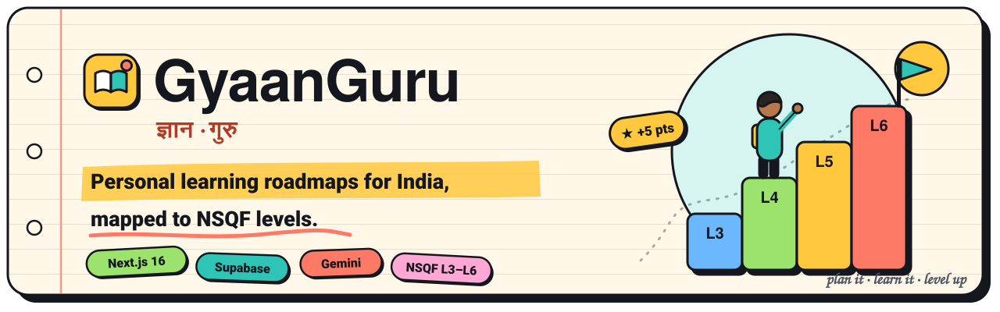
</p>

GyaanGuru turns "I want to learn X" into a plan you can follow week by week.

You tell it what you want to learn, where you're starting from and how many hours a week you have. It builds a roadmap of modules and lessons, rates it on India's NSQF scale (levels 3–6), and then helps you work through it: notes for every lesson, a quick quiz, a tutor you can ask, videos, and live jobs that match what you're learning.

It's one Next.js app, with Supabase for accounts and data and Google Gemini for everything the AI writes.

<table>
  <tr>
    <td width="50%">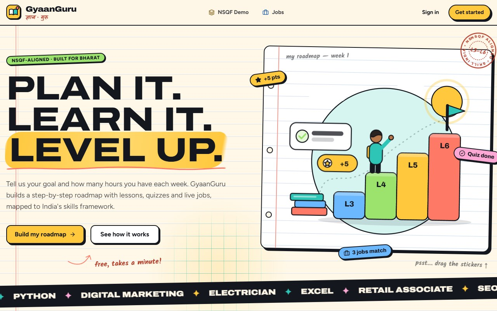</td>
    <td width="50%">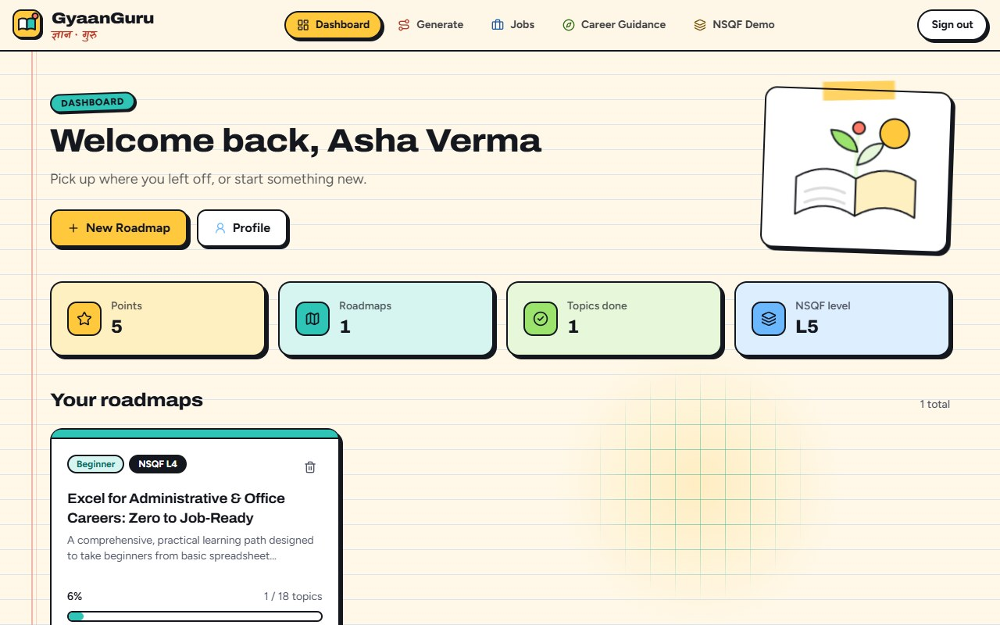</td>
  </tr>
  <tr>
    <td><sub>The home page. The ruled paper turns into graph paper under your cursor, and the stickers can be dragged around.</sub></td>
    <td><sub>Your dashboard: points, roadmaps, lessons done and current NSQF level.</sub></td>
  </tr>
</table>

## What you can do with it

**Plan**
- Generate a roadmap from a topic, your level, your goal and your weekly hours. Each one gets an NSQF level and example job roles.
- Map a three-step path across NSQF levels from your education and skills, either rule-based or written by Gemini.

**Learn**
- Read notes written for each lesson, take a four-question quiz, and ask the AI instructor about the lesson.
- Watch YouTube lectures picked for the topic.
- See the whole roadmap as a map of connected modules and lessons.

**Track**
- Tick off lessons to earn 5 points each, keep a daily streak and collect badges.
- Your dashboard shows progress for every roadmap.

**Get guidance**
- **AI Mentor**: a chat that knows your roadmaps, progress and goals, and can plan your week.
- **Career chat** for learners, trainers and policymakers, grounded in your profile and NSQF reference data.
- **Resume matcher**: a match score for a role, your strengths, the skills to add, and courses that cover them.
- **Career path simulator**: compare two courses on typical roles, salary ranges in India, demand and time to job-ready.
- **Jobs**: live listings across India from Adzuna.

<table>
  <tr>
    <td width="50%">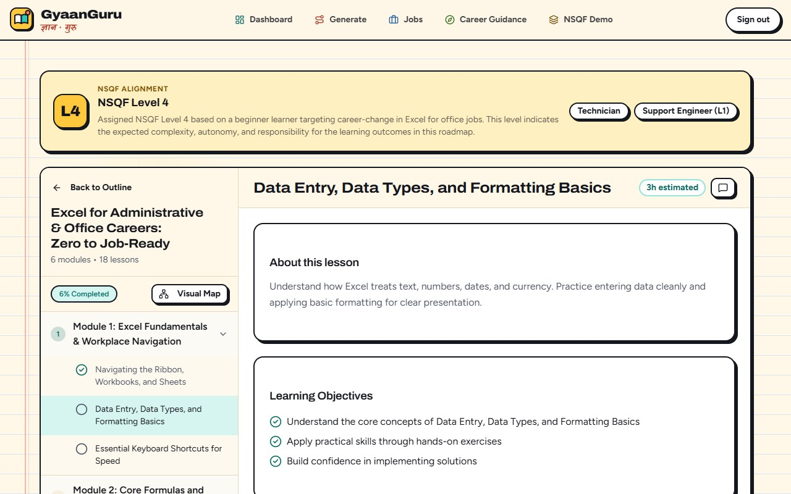</td>
    <td width="50%">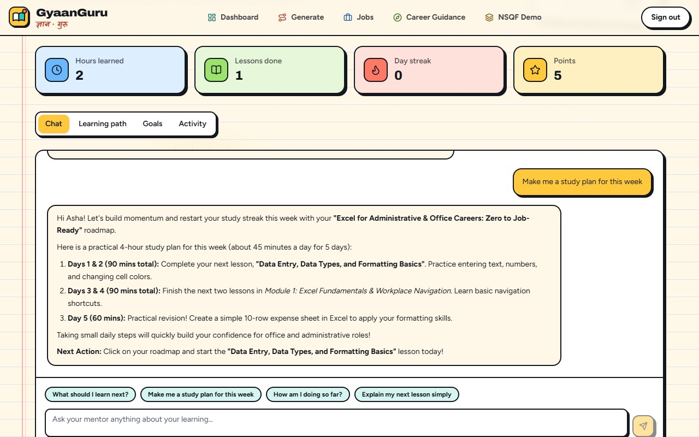</td>
  </tr>
  <tr>
    <td><sub>A real roadmap Gemini wrote for "Excel for office jobs", rated NSQF Level 4.</sub></td>
    <td><sub>The AI Mentor uses your actual roadmap and next lesson to plan your week.</sub></td>
  </tr>
</table>

## How it fits together

<p align="center">
  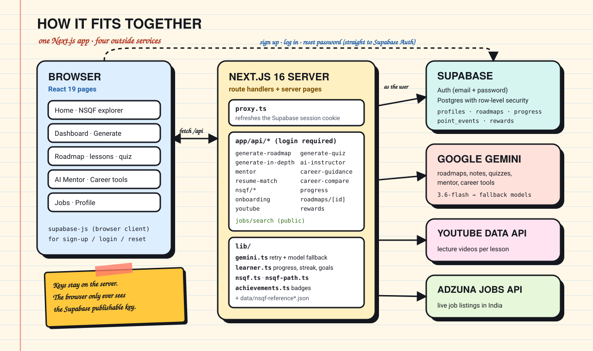
</p>

The browser never holds a secret. Signing up, logging in and resetting a password go straight to Supabase Auth with the publishable key. Everything else goes through the app's own `/api` routes. They check your session, read and write your data as you (so the database's row-level security applies), and are the only place the Gemini, YouTube and Adzuna keys are used.

### What happens when you generate a roadmap

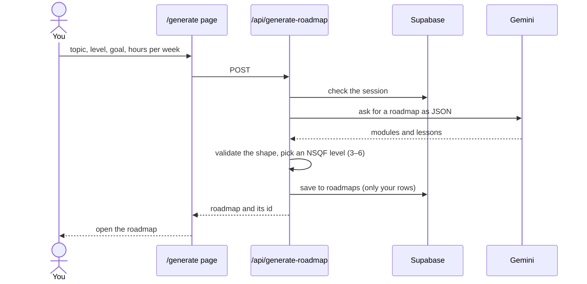

### When Gemini is busy

Free Gemini keys have small per-minute and per-day limits for each model, and Google's models are sometimes overloaded. Every AI call goes through `lib/gemini.ts`, which works around that:

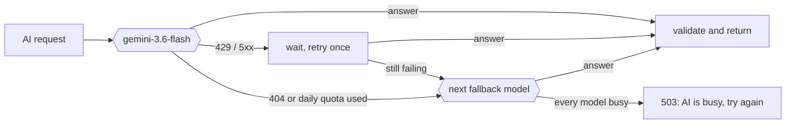

The screens show that message with a **Try again** button instead of failing silently.

### Data

Three tables in Supabase, all protected by row-level security so people only ever see their own rows:

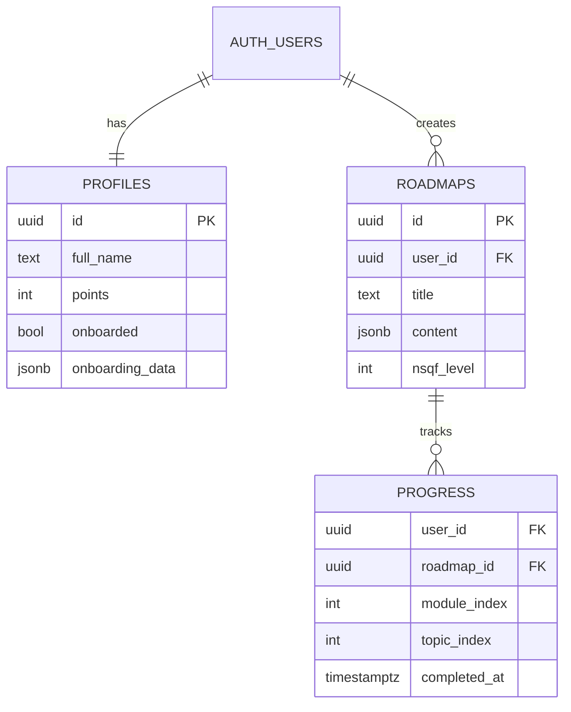

Badges, streaks and hours learned aren't stored. They're worked out from `progress` each time (`lib/learner.ts`, `lib/achievements.ts`). Points change through one SQL function, `adjust_points()`, so double-clicking a lesson can't award them twice.

## Running it locally

### You'll need

- Node.js 20.9 or newer
- A free [Supabase](https://supabase.com) project
- A Gemini API key from [Google AI Studio](https://aistudio.google.com)
- Optional: a [YouTube Data API v3](https://console.cloud.google.com) key for lesson videos, and an [Adzuna](https://developer.adzuna.com) app ID and key for live jobs

### Steps

1. **Get the code**

   ```bash
   git clone https://github.com/srikantlose/gyaanguru.git
   cd gyaanguru
   npm install
   ```

2. **Set up Supabase**
   - In your project's **SQL Editor**, paste all of [`scripts/schema.sql`](scripts/schema.sql) and run it. It creates the tables, security rules and sign-up trigger, and it's safe to run again.
   - Under **Authentication → Sign In / Providers → Email**, turn off **Confirm email** while you're developing, so new accounts work straight away.
   - Under **Authentication → URL Configuration**, set the Site URL to `http://localhost:3000` and add `http://localhost:3000/**` to Redirect URLs. Password-reset links need this.

3. **Add your keys**

   ```bash
   cp .env.example .env.local
   ```

   Then fill in `.env.local`:

   | Variable | Needed? | What it's for |
   |---|---|---|
   | `NEXT_PUBLIC_SUPABASE_URL` | yes | Project URL, e.g. `https://abcd.supabase.co` |
   | `NEXT_PUBLIC_SUPABASE_ANON_KEY` | yes | The publishable (anon) key. Never the secret key. |
   | `GEMINI_API_KEY` | yes | Roadmaps, notes, quizzes, mentor and career tools |
   | `YOUTUBE_API_KEY` | optional | Lesson videos. Without it, lessons show a short note instead. |
   | `ADZUNA_APP_ID`, `ADZUNA_APP_KEY` | optional | Live jobs. Without them, the jobs page shows sample listings. |
   | `GEMINI_MODEL` | optional | Use a different main model (default `gemini-3.6-flash`) |
   | `GEMINI_FALLBACK_MODELS` | optional | Comma-separated models to try when the main one is busy |
   | `GEMINI_BASE_URL` | optional | Send Gemini calls through a proxy or a local test stub |

4. **Run it**

   ```bash
   npm run dev
   ```

   Open http://localhost:3000 and sign up.

### Scripts

| Command | What it does |
|---|---|
| `npm run dev` | Development server on port 3000 |
| `npm run build` / `npm run start` | Production build, then serve it. The build fails on type errors. |
| `npm run typecheck` | `tsc --noEmit` |
| `npm run lint` | ESLint |

## Where things live

```text
app/
  page.tsx                 home page
  dashboard/  generate/  roadmap/[id]/  ai-mentor/  career-guidance/  jobs/  nsqf/demo/
  auth/                    login, sign-up, forgot and reset password
  api/                     route handlers (all AI, data and third-party calls)
components/
  roadmap-visualization.tsx   the lesson view: outline, notes, quiz, instructor, videos
  mentor-client.tsx           AI Mentor
  illustrations.tsx  doodles.tsx  page-header.tsx   the notebook look
  ui/                         buttons, cards, inputs (shadcn/ui, restyled)
lib/
  gemini.ts       Gemini client with retries and model fallback
  learner.ts      one snapshot of a learner's progress, used to ground the AI
  nsqf.ts  nsqf-path.ts  achievements.ts
scripts/schema.sql   the whole database, idempotent
data/                NSQF reference data (levels, roles, courses)
```

## Good to know

- **Gemini limits.** A free key goes a long way for one person, but heavy use, or running tests against it, can use up a model's daily allowance. The app falls back to other models and tells you when they're all busy. Turning on billing for the key raises the limits.
- **Emails.** Supabase's built-in email sender only delivers to people on your Supabase team, a few per hour. That's enough for testing password resets on your own account. To email anyone else, add your own SMTP server under **Authentication → Emails**.
- **NSQF levels.** The framework runs from 1 to 10. This app assigns levels 3–6, which is the range its reference data covers.
- **Grounding, not search.** The career chat and mentor use your profile, your progress and the app's NSQF reference data. They don't search the web or any external documents.

## The look

The interface is meant to feel like a well-used notebook rather than a dashboard: ruled paper, ink outlines, hard shadows, flat bright colours, stickers, washi tape, a rubber stamp and handwritten notes (in Kalam, which also covers Devanagari). Every illustration is hand-built SVG in [`components/illustrations.tsx`](components/illustrations.tsx). It works on phones too.

<p align="center">
  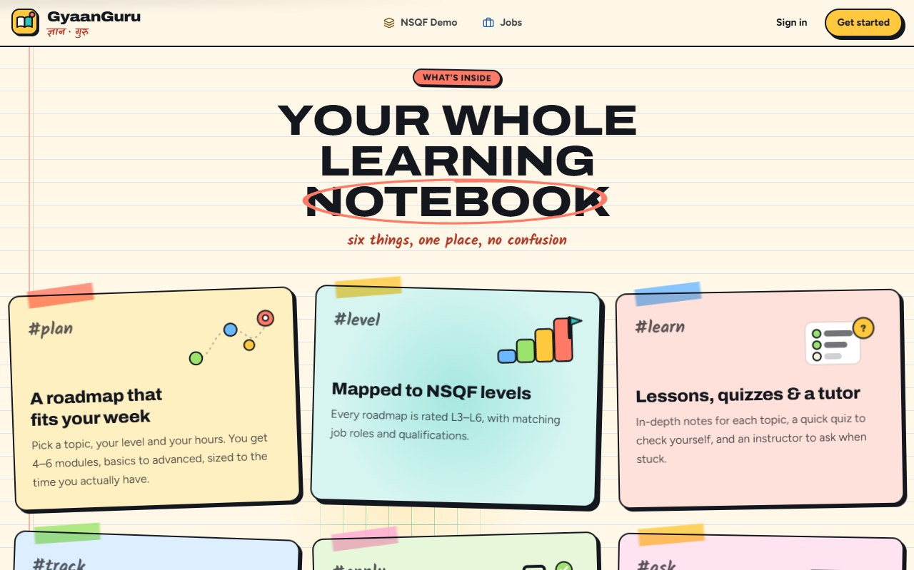
  &nbsp;
  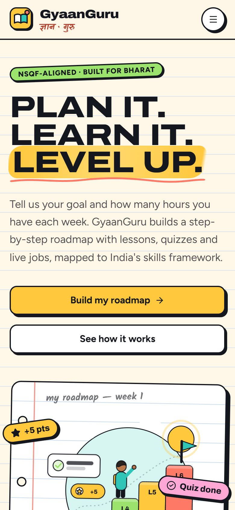
</p>

## License

[MIT](LICENSE) © 2026 Srikaanth
